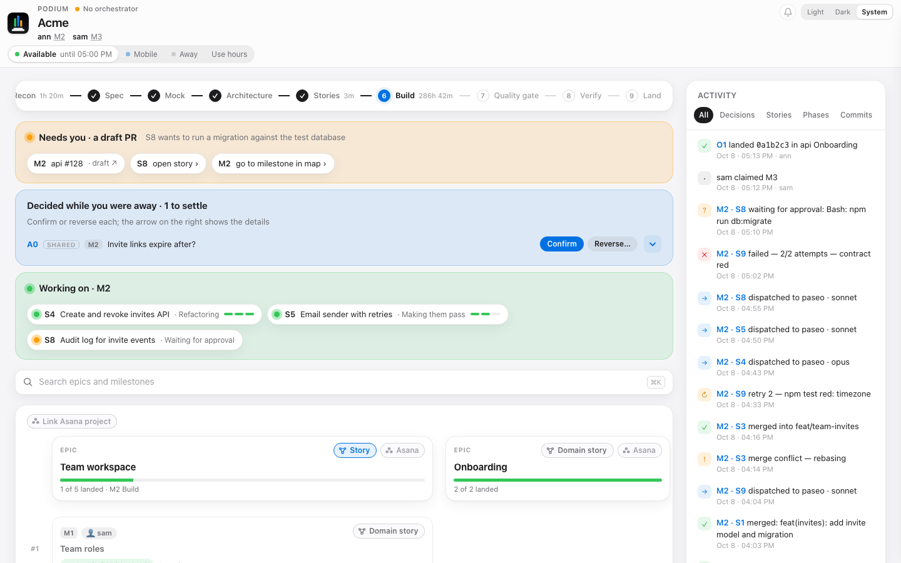

# podium-dashboard

Podium is a live localhost dashboard and a run-state CLI for feature work that agents build in parallel. A run is a folder of JSON and text files (epics, milestones, stories, events, progress lines); `podium` reads and changes it, and the dashboard shows it. Python 3.9 or later, standard library only. It grew out of Claude Code orchestration skills, but nothing in it depends on them.



## Install

```
pip3 install --user git+https://github.com/warriv93/podium-dashboard
```

Or from a clone, so edits take effect at once:

```
pip3 install --user -e .
```

This puts `podium` on your path. Check with `podium --version`.

## Quick start

`sample/` is a run in progress for a made-up product, Acme.

```
podium --dir sample status
podium --dir sample server --detach
```

`status` prints the active milestone, who owns what and each story's state. `server --detach` prints a `http://127.0.0.1:<port>/` URL; open it. The server stops by itself after an hour without use.

`podium` with no `--dir` finds the run for you: `$PODIUM_DIR`, else the nearest directory at or above the current one that holds `podium/podium.json`.

To start your own run, `podium init --name my-tool --command /my-tool --extension ./ext.py` creates `podium/podium.json`. Then add epics, milestones and stories with `podium set`, see `docs/SCHEMA.md`.

## Commands

| Command | What it does |
|---|---|
| `status [--all] [--milestone ID]` | compact view of the run |
| `get <target>` | a project, epic, milestone or story as JSON |
| `set <target> key=value ... [--event TYPE ...]` | change fields, append an event; `batch` does several in one write |
| `ready [--milestone ID]` | ids of the stories whose dependencies are done |
| `log [<milestone>/<story>] <STAGE> <note>` | append a progress line for a story |
| `assume`, `assumptions`, `settle` | record, list and settle assumptions made while you were away |
| `claim <milestone>`, `release <milestone>`, `whoami [name]` | ownership in a shared run |
| `sync on\|off\|save\|pull\|status` | share the run through git |
| `asana link\|refresh` | link a run to an Asana project or task and read its progress back, see Linking Asana |
| `hours`, `human` | your working hours and availability, per machine |
| `requests` | the button presses nobody has handled yet |
| `server`, `watch` | the dashboard, and the watcher an orchestrator listens to |
| `init` | name the run's orchestrator and its extension |

`podium --help` has the full reference. Targets are `.` (the project), `me`, `epic:<id>`, `milestone:<id>`, `<story>` of the active milestone, or `<milestone>/<story>`.

## Linking Asana

`podium asana link <url> [. | epic:<id> | milestone:<id>]` links the project, an epic or a milestone to an Asana project or task, and `podium asana refresh` reads every link back: assignee, custom fields, completion, and the subtasks of a linked task as milestones. Refresh needs a personal access token, from `$ASANA_TOKEN` or the macOS keychain:

```
security add-generic-password -s podium-asana -a "$USER" -w
```

Without a token `refresh` prints `NO_TOKEN` and exits 3; a failed read prints `ASANA-ERROR` and exits 1. The output lines are in [docs/PROTOCOL.md](docs/PROTOCOL.md).

## Writing an orchestrator extension

The core knows run state, not what your orchestrator does. Your orchestrator adds verbs (`launch`, `merge`, ...), the prompts the dashboard's buttons hand out, and any extra request actions in one Python file, registered with `podium init`. `examples/minimal_extension.py` is a working one:

```
podium --dir sample hello
```

The full contract is in [docs/PROTOCOL.md](docs/PROTOCOL.md), the files in [docs/SCHEMA.md](docs/SCHEMA.md).

## Sharing a run between two machines

Sync commits the run's state onto a git ref and pushes it to a private repo you choose. Nothing in your working trees changes.

```
podium sync on --remote git@example.com:acme/podium-runs.git
podium claim M2
```

`sync on` prints the ref it uses. The second machine joins with the same remote and ref, then pulls:

```
podium --dir acme sync on --remote git@example.com:acme/podium-runs.git --ref refs/heads/podium-run/acme
podium --dir acme sync pull
```

Sync carries the run's state files and its planning docs: Markdown files anywhere in the run dir, `spec/`, `mock/` and `domain-stories/`. Each person claims their milestones, so changes stay apart; `podium.json` merges, `events.jsonl` and progress files union (the progress of your own milestones stays as your machine has it), and a text conflict keeps your file and writes the other as `<file>.remote`. While the watcher runs it pulls every minute and prints `SYNCED <sha> <summary>` when someone else's change arrives. The merge rules are in [docs/PROTOCOL.md](docs/PROTOCOL.md).

## Security

The server binds to `127.0.0.1` only and refuses any request whose `Host` is not `127.0.0.1:<port>` or `localhost:<port>`. Any request but a GET or HEAD from a page with another `Origin` is refused too. There is no login: anyone with a shell on your machine can reach it, so do not forward the port.

## Trust model

Sharing a run through `podium sync` means trusting everyone who can push to its remote: what they write, such as story briefs and the prompts built from the run's state, becomes instructions for your agents.

What a pull never does: run code. The extension is a `.py` file each machine sets itself (a machine takes the run's only on its first join, and never again); Python files and native modules never sync; the orchestrator skills run a contract command from synced state only after you `podium approve` it. A pull writes only the run's files that this machine's own include and exclude lists carry, inside the run dir and never through a symlink, and never touches the progress of milestones you own.

What it accepts: a repo path in `podium.json` may point at any repo on disk, and git runs there (always with `safe.bareRepository=explicit`). The dashboard sets no frame policy, so another site may frame it, and a click inside that frame is a click on the dashboard.

## License

MIT, see [LICENSE](LICENSE).
