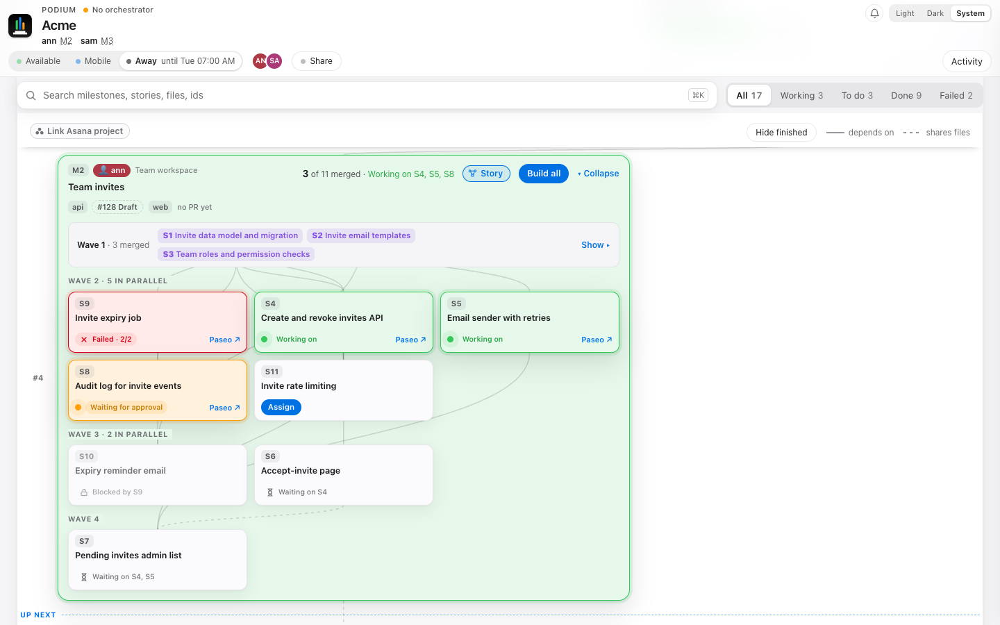

# podium-dashboard

Podium is a live localhost dashboard and a run-state CLI for feature work that agents build in parallel. A run is a folder of JSON and text files (epics, milestones, stories, events, progress lines); `podium` reads and changes it, and the dashboard shows it. Python 3.9 or later, standard library only. It grew out of Claude Code orchestration skills, but nothing in it depends on them.



[`docs/podium-deck.pptx`](docs/podium-deck.pptx) is an 18-slide talk on Podium and the [deep-skills](https://github.com/warriv93/deep-skills) suite that drives it: many agents building in parallel from one plan, the suite as a layer cake, the ideas it borrows, the loop caps and model routing that keep them cheap, the quality gates, and what it has shipped so far. [`docs/podium-deck.js`](docs/podium-deck.js) builds it with pptxgenjs.

## Install

```
pip3 install --user git+https://github.com/warriv93/podium-dashboard
```

Or from a clone, so edits take effect at once:

```
pip3 install --user -e .
```

This puts `podium` on your path. Check with `podium --version`.

`podium self-update` brings the first kind of install up to the repo's HEAD, at most once per 6 hours (`--force` now, `--check` to only report).

## Quick start

`sample/` is a run in progress for a made-up product, Acme.

```
podium --dir sample status
podium --dir sample server --detach
```

`status` prints the active milestone, who owns what and each story's state. `server --detach` prints a `http://127.0.0.1:<port>/` URL; open it. The server stops by itself after an hour without use.

Each run keeps its port from one start to the next, and with it the page's settings in your browser: the first start takes the first free port of 8765-8784 that no other run holds, and records it as the run's lease in `~/.podium/ports.json`. A lease lasts 7 days from the run's last use. Starting a run that is already served prints where and exits 1; a leased port something else holds gives the run another free port for that start. `--port` overrides the lease and becomes it. `podium ports` lists the leases: `release <slug>` drops one, `pin <slug>` keeps one from expiring.

`podium` with no `--dir` finds the run for you: `$PODIUM_DIR`, else the nearest directory at or above the current one that holds `podium/podium.json`.

To start your own run, `podium init --name my-tool --command /my-tool --extension ./ext.py` creates `podium/podium.json`. Then add epics, milestones and stories with `podium set`, see `docs/SCHEMA.md`.

## Commands

| Command | What it does |
|---|---|
| `status [--all] [--milestone ID]` | compact view of the run |
| `get <target>` | a project, epic, milestone or story as JSON |
| `set <target> key=value ... [--event TYPE ...]` | change fields, append an event; `batch` does several in one write |
| `ready [--milestone ID]` | ids of the stories whose dependencies are done |
| `log [<milestone>/<story>] <STAGE> <note>` | append a progress line for a story |
| `assume`, `assumptions`, `settle` | record, list and settle assumptions made while you were away |
| `claim <milestone>`, `release <milestone>`, `whoami [name]` | ownership in a shared run |
| `decision add\|claim\|resolve\|outscope\|invalidate\|unresolved`, `decisions [--epic ID] [--json]` | epic-wide questions settled before the milestone cut, with the frontier to work next |
| `sync on\|off\|save\|pull\|status` | share the run through git |
| `finding add\|resolve\|wontfix`, `findings [--all] [--open] [--recur]` | record what went wrong or cost too much under a key reused when it recurs, and list the keys across runs, see Findings |
| `tokens [--since 7d] [--cwd <path>]... [--top N] [--json]` | where Claude Code's tokens went in the last week, and the recurring tool calls worth fixing, see Findings |
| `asana link\|refresh` | link a run to an Asana project or task and read its progress back, see Linking Asana |
| `ls stories\|milestones [--milestone ID] [--fields a,b]` | one line per story or milestone |
| `hours`, `human [set <mode> [--until HH:MM]]` | your working hours and availability, per machine; `human set` flips the toggle |
| `ports [release\|pin\|unpin <slug>]` | each run's port lease on this machine, whether it is served, when it was last used |
| `requests` | the button presses nobody has handled yet |
| `server`, `watch` | the dashboard, and the watcher an orchestrator listens to |
| `init` | name the run's orchestrator and its extension |

A milestone may wait for another without being held back: its `waitsFor` puts a "Waiting for M10" pill and a banner on the dashboard, whose Go ahead queues a `proceed` request, and `status` appends ` · waiting for M10` (see `docs/SCHEMA.md`).

`podium move M10 --to M11 [--pattern <slug>]` folds a milestone into another: M10 turns `moved`, M11 `includes` it, and a wait on M10 becomes "waiting for M11 (was M10)".

Questions that touch two or more milestones of an epic are settled first, as decisions: `podium decision add "Which auth?" --type discussion --affects "M1,M2"` prints `DECISION D1 open` (at most 6 open per epic without `--force`), `decision claim D1` makes it yours, and `resolve`, `outscope` or `invalidate` close it with the outcome (`unresolved` keeps it open with what is missing); on a decision someone else claimed, these need `--force`. `podium decisions` lists them and ends with `FRONTIER D1,D4` (open, unclaimed, every blocker closed) and `STATE ACTIVE|WAITING|BLOCKED|CLEAR`; cut the epic once it is `CLEAR`.

`podium --help` has the full reference. Targets are `.` (the project), `me`, `epic:<id>`, `milestone:<id>`, `<story>` of the active milestone, or `<milestone>/<story>`.

## Linking Asana

`podium asana link <url> [. | epic:<id> | milestone:<id>]` links the project, an epic or a milestone to an Asana project or task, and `podium asana refresh` reads every link back: assignee, custom fields, completion, and the subtasks of a linked task as milestones. Refresh needs a personal access token, from `$ASANA_TOKEN` or the macOS keychain:

```
security add-generic-password -s podium-asana -a "$USER" -w
```

Without a token `refresh` prints `NO_TOKEN` and exits 3; a failed read prints `ASANA-ERROR` and exits 1. The output lines are in [docs/PROTOCOL.md](docs/PROTOCOL.md).

## Findings

A run records a **finding** when something went wrong or cost too much, under a short kebab-case key that a later run reuses for the same problem: `podium finding add --key gate-reran --kind retro --target feature-qa --title "…" --moment "<evidence>" --fix check --severity normal`. It goes into the run's events (the dashboard's feed shows it) and onto the ref `refs/heads/findings/<run slug>` of the git remote the extension names as `FINDINGS_REMOTE`, file `findings.jsonl`, one JSON record per line, without touching any working tree. With no `FINDINGS_REMOTE` the event is still recorded. `podium finding resolve <key> --sha <sha> --repo <repo>` and `podium finding wontfix <key> --why "<why>"` close a key the same way; outside a run they take `--remote <url>` and write to `refs/heads/findings/resolutions`.

`podium findings` lists the run's own findings grouped by key; `--all` reads every run's ref on the remote (outside a run, `--remote <url>`, repeatable): `FINDING <key> ×<runs> <open|resolved <sha>|wontfix> <kind> <target> <severity>[ ~<saving>/wk] — <title>`. A closed key is open again when it recurs later. `podium findings --recur` prints `RECUR <key> ×<runs> — <title>` for open keys seen in two runs or more, or marked high, at most once a day per machine: an orchestrator's turn can pass those lines on.

`podium tokens` is where a `tokens` finding's evidence comes from. It reads Claude Code's session logs under `~/.claude/projects` (subagents included) since `--since` (default `7d`, or an ISO time), for sessions whose cwd is under a `--cwd`, with no model calls, and prints `TOTAL <tokens> sessions <n>`, a `MODEL <model> <tokens>` line per model, and `PATTERN <kind> ×<count> ~<tokens>/wk <normalized>` lines ranked by tokens per week: `big-output` (large tool results), `repeat-command` (the same Bash command, with paths, shas, numbers and quoted strings as placeholders, in several sessions), `reread` (the same file read in several sessions) and `sequence` (the same three tool calls in a row in several sessions). `--top N` keeps N of each kind (default 10), `--json` prints one object.

## Writing an orchestrator extension

The core knows run state, not what your orchestrator does. Your orchestrator adds verbs (`launch`, `merge`, ...), the prompts the dashboard's buttons hand out, and any extra request actions in one Python file, registered with `podium init`. `examples/minimal_extension.py` is a working one:

```
podium --dir sample hello
```

The full contract is in [docs/PROTOCOL.md](docs/PROTOCOL.md), the files in [docs/SCHEMA.md](docs/SCHEMA.md).

## Sharing a run between two machines

Sync commits the run's state onto a git ref and pushes it to a private repo you choose. Nothing in your working trees changes.

```
podium sync on --remote git@example.com:acme/podium-runs.git
podium claim M2
```

`sync on` prints the ref it uses. The second machine joins with the same remote and ref, then pulls:

```
podium --dir acme sync on --remote git@example.com:acme/podium-runs.git --ref refs/heads/podium-run/acme
podium --dir acme sync pull
```

Sync carries the run's state files and its planning docs: Markdown files anywhere in the run dir, `spec/`, `mock/` and `domain-stories/`, plus any document `podium.json` references inside the run dir (an artifact, a brief, a spec, a ledger), unless excluded. Each person claims their milestones, so changes stay apart; `podium.json` merges, `events.jsonl` and progress files union (the progress of your own milestones stays as your machine has it), and a text conflict keeps your file and writes the other as `<file>.remote` (`<file>.2.remote`, `.3.remote`, ... while an earlier conflict's copy is still there). While the watcher runs it pulls every minute and prints `SYNCED <sha> <summary>` when someone else's change arrives. The merge rules are in [docs/PROTOCOL.md](docs/PROTOCOL.md).

The dashboard's **Share** button queues a `share` request for your orchestrator, which switches sync on and prints the colleague's steps in its chat. Once the run syncs, the button reads **Shared** and its tooltip lists those steps with the run's ref and remote filled in: the extension's `SHARE_STEPS` when it has them, else install this tool, install the orchestrator's skill, run `<orchestrator command> join <ref>` in a new empty folder, and `podium claim <milestone>`. In a run that syncs, the Podium server also pulls your colleagues' changes every minute on its own, orchestrator or not, and the **Fetch** button beside **Share** pulls them at once.

Every side sheet has a **Copy link** button left of its close button: the link (`http://127.0.0.1:8765/open?run=<run slug>#/M24`, or `#/M2/S8`, or `#/M24/doc/spec/m24/spec.md`) opens in a colleague's own Podium: `#/M24` opens milestone M24 on the map, `#/M2/S8` opens M2 on the map and story S8's sheet, and a `/doc/` link opens that document's sheet. Port 8765 is where a Podium starts, and any Podium there sends the link on to the server of that run on the colleague's machine, whatever port it took: the run's leased port, else any of 8765-8784. A run with a lease that isn't served is started from the dir the lease names, then opened. With no Podium running on 8765-8784 the browser can't connect, and one that finds neither the run nor a lease for it answers a page with `podium server --detach` to start it in their checkout.

The ▾ beside the run's title lists every run with a lease on this machine, a green dot on those served now, with a tick on this one. Click another to open it, or, when it is stopped, to start it from its own dir and then open it.

A brief or file list that names a mock under the run dir's `mock/` (an HTML page, a picture, or a folder with an `index.html`, such as `mock/m10/auth-screens.html#proposed` or `feature-folder/mock/r6/`) links it with 🎨: it opens in a new tab from this Podium, so a colleague on the shared run opens the same mock, which `podium sync` carries with the run. A mock that isn't in the run yet shows greyed with "not built yet" instead of a link that would 404.

In a shared run, clicking a milestone's owner badge, or **Claim** on one nobody owns, opens a pulldown of the run's people with its owner ticked: pick a colleague to give it to them, or **Unassign** to put it up for Claim again (`POST /owner/<milestone>?to=<person>`, `?to=` for nobody; written at once with `handover` and `owner` events, pushed when the run syncs, no watcher needed). Anyone may move any milestone, except while one of its stories is building or awaiting approval. A click outside a pulldown, or Escape, closes it. A milestone someone else gave you shows a **Given to you** banner (and counts in the tab title and notifications) until you press Got it, kept in the browser under `podium-handed-seen:<run slug>`.

Each Podium server writes the commit it runs to `people.<me>.podium` when it starts, and every 30 minutes (`--version-every`, 0 never) checks it against the repo's HEAD, counting the commits in between through GitHub's compare API. Anyone behind shows as an amber hint beside the avatars, such as `ML · e6f6b8c, 31 behind`; nobody up to date shows one. Your own hint says whether to press Restart (the latest is installed) or run `podium self-update` first.

Choices kept in the browser carry the run's slug, so a port another run takes later doesn't inherit them; the theme and the season's snooze are yours across runs.

The **Hide finished** button in the map header drops landed and moved milestones from the map and, inside the open milestone, merged or dropped stories (a finished item that is open or needs you stays, and the button counts what it hides); the choice is kept in the browser under `podium-hide-finished:<run slug>`.

**Collapsed**, beside it, shows every closed milestone as one line (id, priority, title and owner) to glance over a long run; the milestone you open still shows in full. Closed milestones and decisions show their owner as initials, like the avatars in the header; the open milestone and its sheet show the full name. The choice is kept in the browser under `podium-collapsed:<run slug>`.

**Priority**, after Collapsed, opens a menu of Must have, Should have and Nice to have; unticking one hides those milestones from the map (the open one stays, epic tiles are never filtered, and the last ticked box can't be unticked), and the choice is kept in the browser under `podium-priority-filter:<run slug>`.

**Mine**, after Priority, narrows the map to the milestones you own and those waiting on you (the one that needs you, a draft PR for you to look at, the one you have open); it counts what it hides and is kept in the browser under `podium-mine:<run slug>`.

A quest with a start date (`podium set . project.quest.start=2026-10-12`, the Monday of its first week) shows its timeline under the quest tile: its weeks (`weeks`, 6 by default) with today marked, the open weeks after them (`openWeeks`, 2 by default), and what is left to reach the goal, overall and for the Must and Should ones: `4 of 10 landed · 6 to go, ≈ 3 a week`, the weekly rate spread over the quest's remaining weeks (none in its last week, the open weeks or after). From the quest's last week until its open weeks end, a wrap-up card sits under the tile to prepare the presentation and the test rounds: the tally, what landed, the Must and Should ones still open, what moved, and who landed how many; **Copy as text** puts it on the clipboard.

A milestone that lands while you watch bursts from its card all year: quiet ticks and sparkles, or the season's own marks when one is on. When the last Must of the quest lands, confetti falls.

From 1 December to 6 January the page dresses up for the season. Light snow falls, the epic tiles get snow on top, the logo wears a Santa hat and a chip counts down to Christmas Eve. About once a minute a bauble or a star drifts by behind the cards, and about every three minutes a reindeer walks along the bottom (click it). Lucia, 13 December, swaps the hat for a candle crown; New Year, 31 December and 1 January, brings a party hat and fireworks, with a show at midnight. The ❄ beside the chip turns the season off until next year (kept in the browser under `podium-season-off`); with reduced motion on, only the hat, the tiles' snow and the chip stay. Halloween (24 October to 1 November) brings falling leaves, bats, a witch hat and a pumpkin walking by. Easter (Palm Sunday to Easter Monday) brings feathers, grass on the tiles, flying eggs and a witch, bunny ears and the Easter bunny with its chicks. Fettisdagen (the Sunday to the Tuesday it falls on) has light snow, a semla on the logo and a rolling semla. Valborg (28 to 30 April) has bonfire sparks drifting up and a student cap. `?season=xmas`, `lucia`, `newyear`, `halloween`, `easter`, `fettisdagen`, `valborg` or `off` on the page's URL forces one. The layer lives in `podium_dashboard/season/`: `season.js` keeps one entry per season (its dates, chip, particles, cap on the tiles, hat, flyers, walk-by and burst), so a new season is one more entry and its art. The third-party files there and their licences are listed in its `NOTICE.md`.

Each milestone card shows its state on a coloured left edge with a glyph before its id: green ✓ landed, blue ● in progress, amber ! waiting on you, red ✕ failed, grey ○ not started. Blue means in progress everywhere on the page, and green only means landed. Each epic's bar splits the same way: green for landed milestones, blue for those in progress.

A milestone or epic marked must have carries a gold **★ Must** pill on the map, one marked should have a soft gold **★ Should** pill; anything unmarked is nice to have. Click the pill on an open milestone (where a nice to have one shows a grey **Nice to have** pill; closed cards leave it out) or in an epic's sheet (a quest's US tiles) to pick another from a pulldown (`POST /priority/<milestone>?level=must|should|nice`, or `/priority/epic/<epic>?level=...`; written to `podium.json` at once, with no watcher needed), or with `podium set milestone:<id> priority=must` (`priority=should`, `epic:<id>` for an epic, `priority=null` clears it).

Beside it, a run with two or more people shows one avatar each (everyone in `podium.json`'s `people` or the `by` of an event; yours has a ring; past five people it shows four and a `+N` chip). A green dot means an event of theirs is under 15 minutes old: recent activity, not live presence. The tooltip names the milestones they own, the one they're on with its phase, and when they were last active.

## Security

The server binds to `127.0.0.1` only and refuses any request whose `Host` is not `127.0.0.1:<port>` or `localhost:<port>`. Any request but a GET or HEAD from a page with another `Origin` is refused too. There is no login: anyone with a shell on your machine can reach it, so do not forward the port.

## Trust model

Sharing a run through `podium sync` means trusting everyone who can push to its remote: what they write, such as story briefs and the prompts built from the run's state, becomes instructions for your agents.

What a pull never does: run code. The extension is a `.py` file each machine sets itself (a machine takes the run's only on its first join, and never again); Python files and native modules never sync; the orchestrator skills run a contract command from synced state only after you `podium approve` it. A pull writes only the run's files that this machine's own include and exclude lists carry, inside the run dir and never through a symlink, and never touches the progress of milestones you own.

What it accepts: a repo path in `podium.json` may point at any repo on disk, and git runs there (always with `safe.bareRepository=explicit`). The dashboard sets no frame policy, so another site may frame it, and a click inside that frame is a click on the dashboard.

What `podium server --lan` exposes: the dashboard on your network, for a browser on another machine. Anyone holding its printed `lan` URL can read the run and press every button, as you can at 127.0.0.1. The key is in that URL and, once opened, in the browser's cookie for it; it is new each time the server starts (a restart keeps it). Without the key a LAN request gets 403, and the network sees the key in clear, as it is plain HTTP: use it on a network you trust.

## License

MIT, see [LICENSE](LICENSE).
